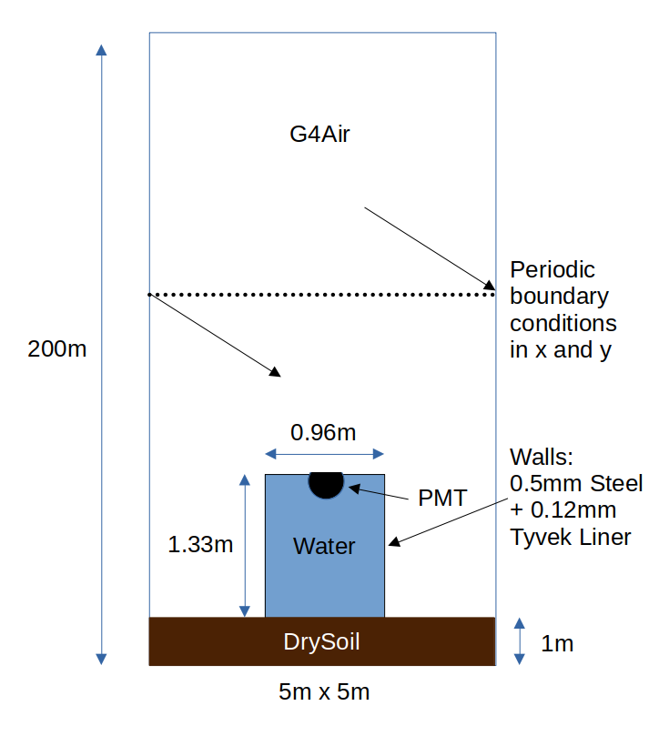
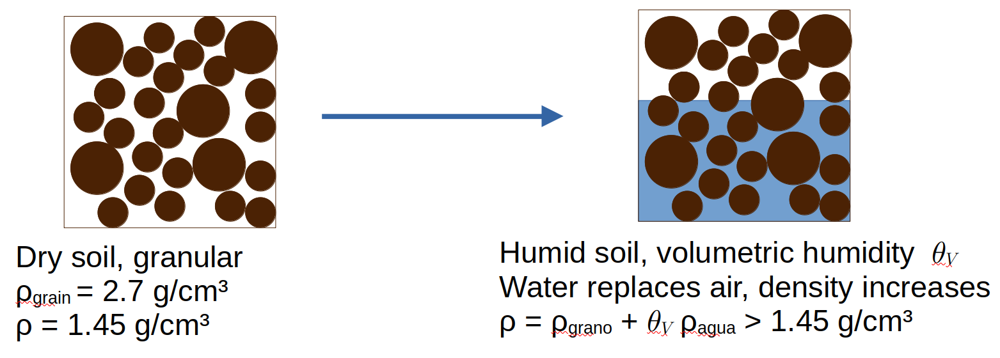

# MEIGA_WCD

## Table of Contents

- [1. Overview and scope](#1-overview-and-scope)
- [2. The two WCD implementations](#2-the-two-wcd-implementations)
- [3. Repository structure](#3-repository-structure)
- [4. Configuration and simulation workflow](#4-configuration-and-simulation-workflow)
- [5. Detector and environment geometry](#5-detector-and-environment-geometry)
- [6. Particle injection](#6-particle-injection)
- [7. Periodic boundary conditions: the “Pacman” implementation](#7-periodic-boundary-conditions-the-pacman-implementation)
- [8. Water material models](#8-water-material-models)
- [9. Soil composition, granular model, and humidity](#9-soil-composition-granular-model-and-humidity)
- [10. Optical diagnostics and analysis](#10-optical-diagnostics-and-analysis)

## 1. Overview and scope

This repository contains a Geant4-based simulation of a water-Cherenkov detector (WCD), built on the MEIGA simulation framework. The project focuses on adapting the detector simulation for studies involving cosmic-ray neutron sensing (CRNS), soil properties, and the optical response of water containing different concentrations of sodium chloride (NaCl).

Two detector implementations form the core of the project:

- **`WCD`** simulates a detector filled with pure water.
- **`SaltyWCD`** uses the same basic detector concept but fills the tank with water whose NaCl concentration can be configured.

Both use a cylindrical tank, a photomultiplier tube (PMT), and optical detection processes. Their implementations are maintained separately, making it possible to modify the two detector models independently. When a change is intended to affect both models, however, care must be taken to keep their corresponding implementations consistent.

This README is a practical guide to the parts of MEIGA most relevant to these WCD simulations. It is not intended to document the whole MEIGA framework or Geant4. Instead, it provides enough orientation to find the important files and make common modifications without needing to understand the entire codebase.

The following sections are organized around individual features. This keeps the documentation relatively self-contained, so that parts of the implementation can be replaced or removed later without making the rest of the README obsolete.

## 2. The two WCD implementations

The two detector implementations are defined primarily in:

- `src/G4Models/WCD.cc`
- `src/G4Models/SaltyWCD.cc`

Their geometry is similar by design, but their water materials differ. The conventional `WCD` assigns `Materials().Water` to the tank volume. `SaltyWCD` instead creates a saline-water material using `Materials().CreateSaltyWater(...)` and assigns it to the tank. The NaCl mass fraction is obtained from the detector configuration.

Both implementations also construct the tank walls from stainless steel, model the PMT using the Pyrex material, and support optional lead shielding. The detector dimensions and several other parameters are read from the configured detector definition rather than being set exclusively in the geometry source code.

### Where to make changes

For common geometry adjustments, start with `DetectorList.xml`, which supplies parameters such as tank radius, height, wall thickness, and shielding thickness. The geometry construction in the corresponding C++ implementation determines how these parameters are translated into Geant4 solids, materials, and placements.

For structural changes—for example, changing the tank shape, adding a component, or changing how the PMT is positioned—inspect the relevant `BuildDetector(...)` method in `WCD.cc` or `SaltyWCD.cc`. If the change should apply to both detector models, check both files.

For changes to the water's composition or optical properties, start with `src/G4Models/Materials.cc`. This is where the underlying material definitions and the saline-water creation method are implemented. The detector classes determine which material is assigned to the tank; the material code determines its physical properties.

This separation is useful to keep in mind: **the detector classes define the physical construction, while the material implementation defines the properties of the substances used in that construction.**

## 3. Repository structure

Most of the relevant code is under `src/`. The following locations are the most useful starting points for WCD-related work.

| Path | Purpose |
|---|---|
| `src/Applications/G4WCDSimulator/` | Main WCD simulation application, detector-construction setup, and configuration templates. |
| `src/G4Models/` | Detector-model implementations and material and physics definitions. |
| `src/Framework/` | Shared simulation data structures, detector definitions, and configuration handling. |
| `src/Utilities/` | Supporting utilities, including primary-particle generation. |
| `src/IO/` | Reading and writing simulation data. |
| `src/Analysis/` | Python tools for inspecting and plotting simulation output. |
| `src/Documentation/SampleFlux/` | Sample input flux data referenced by the example configuration. |

Three locations are particularly important when modifying the detector simulation:

- `src/Applications/G4WCDSimulator/G4WCDConstruction.cc` sets up the world and ground volumes and places the configured detector models.
- `src/G4Models/WCD.cc` and `src/G4Models/SaltyWCD.cc` implement the two WCD geometries.
- `src/G4Models/Materials.cc` defines the materials assigned to those geometries, including water and saline water.

The runtime configuration files are also located under `src/Applications/G4WCDSimulator/`. Their role is explained below, because the distinction between these source files and the files used in a compiled build is important.

## 4. Configuration and simulation workflow

The primary run-specific configuration is split between `G4WCDSimulator.json`, which controls general simulation settings, and `DetectorList.xml`, which supplies detector and injection parameters. MEIGA also reads `src/Framework/ConfigManager/DetectorProperties.xml` to initialize framework defaults; values supplied for individual detectors in `DetectorList.xml` override the corresponding defaults.

**The files under `src/` are templates. They are not automatically the files read by an already-built executable.**

When the `G4WCDSimulator` target is built, CMake copies `G4WCDSimulator.json` and `DetectorList.xml` into:

```text
build/Applications/G4WCDSimulator/
├── G4WCDSimulator
├── G4WCDSimulator.json
└── DetectorList.xml
```

Here, `build/` represents the chosen build directory. The executable uses the configuration file supplied through its `-c` option, and the JSON configuration specifies the detector-list file to load. In the usual build layout, these references point to the copies in the build tree.

This distinction matters in practice:

- **To adjust the configuration of an existing build**, edit the corresponding files in `build/Applications/G4WCDSimulator/`.
- **To change the version maintained in the repository**, edit the templates under `src/Applications/G4WCDSimulator/` and ensure the updated files are copied into the build directory before running the simulation.

Changing a template does not, by itself, change a configuration file that is already present in the build directory. Neither is it necessary to change the template file for every small simulation-specific paramater modification.

### The JSON configuration

`G4WCDSimulator.json` controls the general run settings, including the input mode and file, output options, simulation mode, and physics list.

The supplied template uses `UseARTI` as the input mode, selects `eFast` as the simulation mode, and specifies `QGSP_BERT_HP` as the physics list. These are example settings rather than universal defaults for every study in the project.

### The XML detector configuration

`DetectorList.xml` defines the detector setup and particle-injection configuration. Its parameters include the detector type and dimensions, injection geometry, ground dimensions, impurity fraction, humidity parameter, and shielding thickness.

These settings determine which detector configuration is requested and supply parameters used by the C++ implementation. For example, changing the configured tank radius changes the value provided to the geometry builder; changing how the tank is constructed requires modifying the corresponding detector implementation.

### From configuration to output

At a high level, the application follows this sequence:

1. Read the JSON run configuration.
2. Read the detector definitions from the XML file referenced by that configuration.
3. Initialize Geant4, including detector construction, physics, and user actions.
4. Simulate the configured primary particles and record the detector response.
5. Write the requested simulation data and enabled diagnostic outputs.

The executable accepts a configuration path using the `-c` option:

```bash
./G4WCDSimulator -c G4WCDSimulator.json
```

The command assumes that the executable and configuration filename are accessible from the current working directory. Relative paths inside the configuration files are also sensitive to where the process is launched. The build-and-run instructions should therefore specify the intended working directory and explain how to check the input and output paths.

For reproducibility, retain the runtime configuration files associated with each simulation. The templates describe the configuration maintained in the repository, whereas the copied files in the build directory describe the settings actually supplied to a particular run.

## 5. Detector and environment geometry

The geometry is constructed in two layers. `G4WCDConstruction.cc` defines the surrounding world and ground, while `WCD.cc` and `SaltyWCD.cc` construct the two detector variants inside that environment. Most dimensions are supplied through `DetectorList.xml`; the C++ code determines how these parameters become Geant4 solids, materials, and placements.

### 5.1 The WCD assembly

Both WCD implementations use a cylindrical water volume enclosed by a stainless-steel tank. The water volume is a `G4Tubs` solid, and the top, bottom, and side walls are constructed as separate volumes. An ellipsoidal PMT model made of Pyrex is positioned at the top of the water volume. The water-to-wall boundaries are assigned the `LinerOptSurf` optical surface model.

The two implementations differ primarily in the material assigned to the water volume:

- `WCD.cc` uses `Materials().Water`.
- `SaltyWCD.cc` creates saline water with `Materials().CreateSaltyWater(...)`, using the configured impurity mass fraction.

Consequently, geometry changes intended for both detectors should normally be applied consistently to both `BuildDetector(...)` implementations. Changes to the composition or optical properties of the water belong in `Materials.cc` instead.

The standard tank dimensions provide a useful reference configuration: a radius of 48 cm, a height of 133 cm, and stainless-steel walls 0.5 mm thick. These values are configurable rather than intrinsic to the model.

The tank's exterior dimensions follow from the water dimensions and the wall thickness. If the water radius is $R$, the tank height is $H$, and the wall thickness is $t$, the outer tank radius is $R+t$, and its total height is

$
H_{\mathrm{tank,outer}}=H+2t.
$

The detector can also be surrounded by optional lead shielding. A positive `shieldThickness` creates a lead layer above the tank and a cylindrical lead layer around its sides. The top layer adds one shielding thickness to the total vertical envelope, giving

$H_{\mathrm{assembly}}=H+2t+s,$

where $s$ is the lead shielding thickness. There is no corresponding bottom lead layer in the current implementation. The outer radial extent, when shielding is enabled, is $R+t+s$.

The lead shielding is toggled through the `shieldThickness` parameter in `DetectorList.xml`. Setting it to zero disables both the top and side shielding; a positive value enables both. Their construction is handled in `WCD.cc` and `SaltyWCD.cc`.

### 5.2 Ground and world placement

The surrounding environment is constructed in `src/Applications/G4WCDSimulator/G4WCDConstruction.cc`. The world is an air-filled box with a fixed height of 200 m, centred at $z=0$. Its horizontal dimensions are read from the configured ground dimensions:

$
L_{\mathrm{world},x}=L_{\mathrm{ground},x},
\qquad
L_{\mathrm{world},y}=L_{\mathrm{ground},y},
\qquad
L_{\mathrm{world},z}=200\,\mathrm{m}.
$

The ground itself is a box placed at the bottom of the world. Its centre is positioned so that its lower surface coincides with the lower world boundary. For a ground thickness of 1 m, the world extends from $z=-100$ m to $z=+100$ m, and the ground occupies $z=-100$ m to $z=-99$ m.

The detector's configured $z$-coordinate acts as the base reference for the tank assembly. In the common setup, the detector is placed at $z=-99$ m, at the top of the 1 m ground layer. With a 133 cm tank, the tank extends approximately 1.33 m above this reference, with its outer shell and shielding extending according to their respective thicknesses. This leaves roughly 199 m between the ground surface and the top of the world, of which about 197.67 m lies above the unshielded tank.

A representative ground configuration used in the studies is $5\,\mathrm{m}\times5\,\mathrm{m}\times1\,\mathrm{m}$. Check the active `DetectorList.xml` before a run, however: the template currently committed in the repository specifies a larger $400\,\mathrm{m}\times400\,\mathrm{m}\times1\,\mathrm{m}$ ground. Since the world dimensions in $x$ and $y$ follow those settings, this difference also changes the horizontal extent of the world.



Ground construction is conditional. `G4WCDConstruction::CreateDetector()` creates the ground only when all three ground dimensions are positive. To disable the ground while retaining a finite horizontal world, set `groundSizeZ` to zero and leave `groundSizeX` and `groundSizeY` positive. This disables the ground volume; it does not disable the world.

For a change to the ground or world construction, start with `G4WCDConstruction.cc`. For tank dimensions, wall placement, PMT placement, or shielding geometry, start with `WCD.cc` and `SaltyWCD.cc`. For parameter changes that can be made without altering the geometry implementation, start with the active `DetectorList.xml`.

## 6. Particle injection

Particle input and injection position are separate parts of the simulation. The input mode determines where particle identities and momenta come from; the injection mode determines where the particles are placed and, in some modes, how their directions are set.

The relevant implementation is primarily in `src/Utilities/PrimaryGenerator.cc`. The available input and injection modes are configured through the JSON and XML configuration files, respectively.

### 6.1 Input sources: ARTI and EcoMug

The JSON setting `Input.Mode` accepts two values:

- **`UseARTI`** reads a shower archive from an ASCII `.shw` file. This is the mode used for the CRNS studies, because it supplies the particle mixture and momenta from an air shower.
- **`UseEcoMug`** generates muons using the EcoMug library. It does not reproduce the full particle mixture from an ARTI shower and is therefore suited to muon-focused studies rather than the full cosmic-ray shower input used here.

For `UseARTI`, `src/IO/ParticleFiller.cc` reads the archive and converts each record into a simulation particle. The supplied sample archive specifies the following **12-column** format:

|Column |Quantity |Units|
|----|----|----|
|1 |CORSIKA particle ID |Dimensionless identifier|
|2–4 |Momentum components $p_x,p_y,p_z$ | GeV/$c$|
|5–7 |Position coordinates $x,y,z$ | m|
|8 |Shower ID |Dimensionless identifier|
|9 |Primary-particle ID |Dimensionless identifier|
|10 |Primary energy |GeV|
|11 |Primary zenith angle |Degrees|
|12 |Primary azimuth angle |Degrees|

The coordinates are provided in metres, momentum and primary energy in GeV, and primary angles in degrees. The particle ID uses the CORSIKA convention, which is converted to the particle encoding used by the simulation. The reader converts the corresponding values into Geant4 units.

Unit check: ARTI’s [showers.cc](https://github.com/lagoproject/arti/blob/6741b79407d415a571012c77585d830d0eea361d/analysis/showers.cc#L585-L598) converts the input position coordinates from centimetres (CORSIKA-internal) to metres before writing the .shw file. Verify this convention against the specific ARTI version used to generate your archive.

The archive's momentum $p_z$ component is sign-inverted when the particle is read. This accounts for the difference between the vertical-coordinate conventions used by the input and the Geant4 simulation. The horizontal momentum components are retained. The later injection-mode handling either preserves this converted direction or replaces it with a vertical downward direction.

### 6.2 Injection modes

The injection mode is selected with the `type` attribute of the `<injectionMode>` element in `DetectorList.xml`. Its `x`, `y`, and `z` values define the injection origin. Depending on the mode, `radius`, `height`, and optional angular limits can also be supplied.

The current implementation supports the following modes:

| Mode | Behaviour |
|---|---|
| `eCircle` | Places particles at a fixed injection height, sampled uniformly over a circular disk around the configured origin. The momentum direction from the ARTI record is retained. |
| `eHalfSphere` | Samples injection positions on a hemisphere around the configured origin, with the radius and angular range controlled by the XML settings. |
| `eVertical` | Places particles at the configured injection origin and forces their direction vertically downward, along $-z$. For ARTI input, the particle identity and momentum magnitude are retained. |
| `eFromFile` | Uses the particle position from the input record rather than generating a new injection position. When using this mode, ensure that the coordinate systems of ARTI and MEIGA are compatible in the specific simulation setup. |
| `eBoxUniform` | Places particles at a fixed injection height and samples their $x$ and $y$ positions uniformly over a rectangular area defined by the configured ground dimensions, centred on the injection origin. |

For the circular mode, the radius is sampled so that positions are uniform in disk area rather than uniform in radius. The half-sphere mode samples directions using a uniform distribution in $\cos\theta$, appropriate for uniform sampling over the spherical surface within the configured angular limits.

With `UseARTI`, injection modes other than `eFromFile` replace the positions from the archive according to the selected mode. The converted particle momenta are retained unless `eVertical` is selected, in which case the direction is forced to $-z$. With `eFromFile`, the archive positions are used directly and the converted momentum direction is retained.

For future large-area simulations, **`eBoxUniform`** is especially useful. It allows injection positions to be distributed across the same horizontal footprint as the world and ground, rather than restricting the injection to a smaller disk. The mode is configured using the existing `<injectionMode>` element; no separate injection-plane geometry has to be constructed in Geant4.

## 7. Periodic boundary conditions: the “Pacman” implementation

The lateral periodic boundary conditions (PBC) provide a way for particles that leave one side of the simulation area to re-enter at the opposite side. The implementation is in `src/Applications/G4WCDSimulator/G4WCDSteppingAction.cc` and is attributed to Luigui Miranda-Leuro.

The informal nickname **“Pacman”** refers to the familiar wraparound behaviour in the game: crossing one side of the play area brings the particle back at the opposite side.

### 7.1 Motivation: treating the flux as an ensemble

The motivation for PBC is the approximate spatial homogeneity of the atmospheric particle flux over the area of interest. Rather than treating the simulated particles as belonging to one isolated shower with a finite footprint, we can view them as an ensemble drawn from many showers in a statistically homogeneous atmosphere.

In this picture, a particle that leaves the simulation area through one lateral boundary has a statistical counterpart from a neighbouring shower that enters through the opposite boundary. The wrapped track represents this ensemble-level replacement; it is not a physical reflection of the particle. This idea is related to the spatial-normalization argument used by ARTI, where the near-ground flux from neighbouring showers can compensate for particles that miss a selected area ([ARTI framework paper](https://link.springer.com/article/10.1140/epjc/s10052-022-10883-z)).

PBC implement this approximation by making the finite horizontal simulation area behave like a repeating tile. This reduces artificial losses at the lateral edges, allowing particles to continue contributing to the detector response rather than being discarded simply because they reached the chosen edge of the simulation box.

### 7.2 Why the geometry has both a `World` and a `Universe`

The geometry in `G4WCDConstruction.cc` uses two nested air volumes:

- **`World`** is the inner simulation box. Its height is 200 m, and its horizontal dimensions are taken from the configured ground dimensions.
- **`Universe`** is the outermost Geant4 volume. Its horizontal dimensions extend 20 m beyond each side of `World`, while its vertical height remains the same.

Although the code calls the inner volume `World`, the outer `Universe` is the volume returned by `G4WCDConstruction::Construct()` and is therefore the actual top-level Geant4 world volume.

This distinction is essential. In Geant4, a track that leaves the top-level world volume is stopped and killed by the transportation process. If the lateral boundary of the simulation box were also the top-level world boundary, a particle crossing it would be lost before it could continue on the opposite side.

Instead, the inner `World` boundary is placed inside the larger `Universe`. When a particle crosses a lateral edge of `World`, it can enter the surrounding air volume and the stepping action can reposition it before it reaches the outer Geant4 boundary. The additional 20 m on each horizontal side provides a safety margin, keeping the crossing within the outer volume so that the periodic repositioning can take place.

The margin is only horizontal: `World` and `Universe` have the same vertical extent. The top and bottom boundaries are therefore not periodic and remain genuine escape boundaries. The `Universe` is a geometric safety volume, not an additional layer of physical atmosphere intended for analysis.

### 7.3 How the wrapping is implemented

The periodic handling is implemented in `G4WCDSteppingAction::UserSteppingAction()`:

1. The code checks the post-step position against the lateral limits of `World`, defined by half its width and length.
2. If the particle has crossed an $x$ or $y$ boundary without simultaneously reaching a vertical boundary, its position is translated to the opposite side. The translation uses the full corresponding world dimension.
3. A 10 cm inward offset is applied to keep the corrected position just inside the boundary.
4. The particle's position is updated and the Geant4 navigator is relocated to the corrected position so tracking can continue.

The momentum direction is not reversed. The particle continues along its existing trajectory, but its position is periodically translated across the horizontal domain.

The vertical boundaries are deliberately treated differently. If the particle reaches the top or bottom of the world, the code does not perform lateral wrapping. Because the outer `Universe` has the same vertical extent as `World`, a particle that escapes through a vertical boundary leaves the actual Geant4 world and is killed.

### 7.4 Practical limitations: repeated detector encounters

PBC is an approximation whose suitability depends on the assumed spatial homogeneity and the dimensions of the simulation area. A small horizontal footprint causes particles to wrap more frequently and can make the result more sensitive to the periodic approximation.

One point to keep in mind for future applications is the possibility of **repeated detector encounters**. After wrapping, a track continues and could later cross the detector again, contributing additional detector response. This deserves particular attention for muons, which can travel long distances through the simulation and may be more likely to encounter the detector after a wraparound, depending on their trajectory and the configured world dimensions.

For this reason, the horizontal size should be chosen with the particle population and intended observable in mind. If repeated encounters could affect the interpretation of detector counts, compare results with a larger simulation footprint and check whether the contribution from wrapped tracks is significant.

To inspect or modify the implementation, start with `G4WCDSteppingAction.cc`. To change the horizontal limits that define the wrapping boundaries, modify the ground dimensions in the active `DetectorList.xml`.


## 8. Water material models

Water and saline-water composition and optical properties are defined in `src/G4Models/Materials.cc`. This file is the main place to look when changing material density, elemental composition, refractive index, or absorption length. Optical properties are attached to Geant4 materials through a `G4MaterialPropertiesTable`, which maps photon energy to properties such as `RINDEX` and `ABSLENGTH`. Geant4 interpolates the tabulated values during optical-photon tracking.

### 8.1 Pure water

The pure-water material, `Water`, is defined as H₂O with a density of $1.0\ \mathrm{g\,cm^{-3}}$. Its refractive index is wavelength-dependent and calculated using an IAPWS-based formulation. The implementation uses a Lorentz–Lorenz refractivity, $R$, to obtain the refractive index:

$
R=\frac{n^2-1}{n^2+2},
\qquad
n=\sqrt{\frac{1+2R}{1-R}}.
$

The expression for $R$ depends on wavelength, temperature, and density. The current table of refractive-index values is calculated for the wavelength grid used by the detector’s optical model. See the [IAPWS release on the refractive index of ordinary water](https://iapws.org/relguide/Rindex.pdf) for the underlying formulation.

The absorption length $L_{\mathrm{abs,w}}(\lambda)$ is supplied separately as a tabulated spectrum. The currently selected `water1AbsLen` array was inherited from the Pierre Auger Offline Framework; the original data provenance is not fully established in this repository. Alternative tables based on data by [Segelstein (1981)](http://hdl.handle.net/10355/11599) and [Mason, Cone and Fry (2016)](https://doi.org/10.1364/AO.55.007163) are also present in `Materials.cc`. These alternatives are not simply interchangeable labels: their differing absorption lengths can change how far Cherenkov photons travel before absorption and therefore affect the predicted photoelectron signal.

The pure-water absorption table is selected in the source code rather than through a run-time configuration option. When comparing baselines, change the selected table deliberately and keep other simulation settings fixed. Record which baseline was used for each run so that differences can be attributed to the optical input rather than to unrelated configuration changes.

### 8.2 Saline water

The saline-water material is constructed by `Materials::CreateSaltyWater(massFraction)`. The input $w$ is the NaCl **mass fraction**, so, for example, $w=0.10$ represents a solution containing 10% NaCl by mass. Although the implementation accepts NaCl mass fractions from 0 to 1, the density fit is based on data only up to approximately the saturation mass fraction, $w \simeq 0.26$. Values beyond that range are extrapolations and should not be treated as physically validated saline-water solutions.

The solution density is parameterized as

$
\rho_{\mathrm{sol}}(w)=
0.998207+bw+cw^2
\quad [\mathrm{g\,cm^{-3}}],
$

where $b=0.7018236$ and $c=0.23534949$, obtained by a fit to data from the 97th edition of the CRC Handbook of Chemistry and Physics, tabulating the density of NaCl solutions up to saturation at $0.26$. The water-density term, $0.998207\ \mathrm{g\,cm^{-3}}$, corresponds to the reference value used for water at $20^\circ\mathrm{C}$. The coefficients are implemented in the source and should be treated as a parameterization, not a universal density law for arbitrary temperatures or concentrations.

The wavelength-dependent refractive index and absorption length are calculated in the `SaltyWaterOptics` namespace using an effective-oscillator model following Bain et al. (2019), *[The Wavelength-Dependent Complex Refractive Index of Hygroscopic Aerosol Particles and Other Aqueous Media: An Effective Oscillator Model](https://doi.org/10.1029/2019GL084568)*. The model estimates the real and imaginary parts of the complex refractive index of the solution from contributions associated with dissolved salt and water.

For the real part, the implementation uses

$
n_{\mathrm{sol}} =
1+\phi_s\frac{2}{\pi}
\frac{B\nu_0}{\nu_0^2-\nu^2}
+\phi_w(n_w-1),
$

where $\nu=1/\lambda$, $n_w$ is the refractive index of pure water, and 

$\phi_s = w \frac{\rho_\text{sol}(w = 1)}{\rho_\text{sol}} \quad$ and $ \quad \phi_w = (1-w) \rho_\text{water}/\rho_\text{sol}$

are the model’s effective salt and water contributions. They are calculated from the solution density $\rho_\text{sol}$, the NaCl mass fraction $w$ and the extrapolated density fit at $w = 1$. The oscillator parameters $B$, $\nu_0$, and $\Gamma$ are taken from the original paper and defined as constants in `SaltyWaterOptics`.

Absorption is calculated through the imaginary part, $k$, of the complex refractive index. Its relation to the absorption length is

$
\alpha(\lambda)=\frac{4\pi k(\lambda)}{\lambda},
\qquad
L_{\mathrm{abs}}(\lambda)=\frac{1}{\alpha(\lambda)}
=\frac{\lambda}{4\pi k(\lambda)},
$

where $\lambda$ is the vacuum wavelength. In the implementation, the solution’s imaginary refractive index contains a modelled salt contribution and a water contribution. The latter is derived from the selected pure-water absorption baseline:

$
k_w(\lambda)=
\frac{\lambda}{4\pi L_{\mathrm{abs,w}}(\lambda)}.
$

Consequently, changing the pure-water absorption table also changes the baseline inherited by saline water. Comparisons between the implemented absorption baselines should therefore be made for both pure and saline water, with concentration and other detector settings held constant.

These optical properties are model inputs rather than a complete empirical description of every saline-water solution. Their accuracy depends on the source data, the validity of the effective-oscillator approximation, and the temperature and concentration ranges of interest. The repository also uses particular reference values and assumptions internally, so future implementations can update the parameterization as better-matched measurements or references become available.

## 9. Soil composition, granular model, and humidity

The soil materials are also defined in `src/G4Models/Materials.cc`. The current implementation uses a dry-soil elemental composition, an effective grain-density value to estimate porosity, and a water-mixing model to represent changes in **volumetric soil moisture**. This is intended to model how the soil’s material composition and water content affect particle transport, including the moderation and return of neutrons from the ground.

### 9.1 Dry-soil composition and density

The elemental mass fractions for `DrySoil` are based on the soil composition reported by Vásquez Ramírez et al. (2021), cited in the report: [*Improvised Explosive Devices and Cosmic Rays*](https://pos.sissa.it/395/480/pdf). The composition is represented by 14 elements:

| Element | Mass fraction (%) | Element | Mass fraction (%) |
|---|---:|---|---:|
| O | 49.00 | Ca | 1.37 |
| Si | 33.00 | K | 1.36 |
| Al | 7.13 | Na | 0.63 |
| Fe | 3.80 | Mg | 0.60 |
| C | 2.00 | Ti | 0.46 |
| H | 0.38 | N | 0.10 |
| S | 0.08 | P | 0.09 |

Note that the table in the quoted source contains a typography error for the fraction of Phosphorus (P). The value denoted here in the table is the correct one.

These are mass fractions of the soil material, not volume percentages of separate mineral grains. They are entered as element fractions in the `G4Material` definition. The source values and their sum should be kept consistent when editing the material. 

The cited paper uses a reference dry-soil density of $2700\ \mathrm{kg\,m^{-3}}$, equivalent to $2.7\ \mathrm{g\,cm^{-3}}$. In this repository, that value is interpreted as an effective **grain or particle density** for estimating the solid fraction of a porous soil. It is not used directly as the density of the simulated bulk soil.

Instead, `DrySoil` is assigned a bulk dry density of $1.45\ \mathrm{g\,cm^{-3}}$. This is a representative modelling choice, motivated by the Australian soil-quality guidance that describes bulk density and notes that values below approximately $1.5\ \mathrm{g\,cm^{-3}}$ are generally desirable for many soils ([Bulk Density – Measurement](https://www.soilquality.org.au/factsheets/bulk-density-measurement)). The factsheet does not establish $1.45\ \mathrm{g\,cm^{-3}}$ as a measured density for a specific soil in this study; the value is an estimate chosen for the model. Actual bulk density varies with soil texture, structure, compaction, and management.

### 9.2 Granular interpretation and porosity

The distinction between grain density and bulk density provides a simple estimate of the soil’s solid and pore-volume fractions. Let $\rho_g$ be grain density and $\rho_d$ be dry bulk density. The estimated solid fraction is

$
\phi_{\mathrm{solid}}=\frac{\rho_d}{\rho_g},
$

and the corresponding porosity is

$
n=1-\frac{\rho_d}{\rho_g}.
$

For the current values,

$
\rho_g=2.7\ \mathrm{g\,cm^{-3}},
\qquad
\rho_d=1.45\ \mathrm{g\,cm^{-3}},
$

the estimated solid fraction is approximately $0.537$, and porosity is approximately $0.463$. In this model, about 46.3% of the bulk soil volume is therefore available as pore space before water is added.

This is a **homogenized granular model** rather than a geometry made from individually placed grains. `DrySoil` remains one uniform Geant4 material with the selected bulk density and elemental composition. The grain-density estimate is used to constrain the pore space available to water; individual grains and the air in the remaining pores are not represented as separate Geant4 volumes.

### 9.3 Adding volumetric soil moisture

The function `Materials::CreateWetSoil(thetaV)` constructs the wet-soil material. Its input, $\theta_v$, is the volumetric water content:

$
\theta_v=\frac{V_{\mathrm{water}}}{V_{\mathrm{bulk\ soil}}}.
$

It is dimensionless: for example, $\theta_v=0.20$ means that water occupies 20% of the total bulk soil volume. It is not the water mass fraction.

The water content is limited by the estimated porosity. Conceptually, the volume fractions are

$
\phi_{\mathrm{water}}=\theta_v,
\qquad
\phi_{\mathrm{air}}=n-\theta_v,
\qquad
\phi_{\mathrm{solid}}=1-n,
$

with $0\leq\theta_v\leq n$. At $\theta_v=n$, the available pore space is fully occupied by water in this idealized description.

The bulk density of the wet soil is calculated by adding the water mass per unit bulk volume to the dry-soil bulk density:

$
\rho_{\mathrm{wet}}=\rho_d+\theta_v\rho_w,
$

where $\rho_w=1.0\ \mathrm{g\,cm^{-3}}$ in the current implementation. The corresponding mass fractions used to build the wet material are

$
f_w=\frac{\theta_v\rho_w}{\rho_{\mathrm{wet}}},
\qquad
f_d=\frac{\rho_d}{\rho_{\mathrm{wet}}},
$

where $f_w$ is the water mass fraction and $f_d$ is the dry-soil mass fraction. These sum to one. The wet-soil `G4Material` is then created with density $\rho_{\mathrm{wet}}$ and those two components.



Air-filled pore space is thus implicit in the porosity limit and bulk-density interpretation; it is not explicitly added as a third component of the wet-soil material. The model also assumes that water is distributed uniformly throughout the soil volume, rather than resolving local moisture gradients or individual wet and dry regions.

To modify the elemental composition, bulk density, grain-density assumption, or water-mixing calculation, start with `Materials.cc`. The soil-moisture value must be supplied to `CreateWetSoil(...)` by the detector/environment configuration for that material to be used in a simulation. The validity of the selected moisture value and the consistency of the density assumptions should be checked whenever the soil model is changed.

## 10. Optical diagnostics and analysis

Optical diagnostics are implemented through Geant4's analysis tools and the WCD-specific run and PMT actions. Rather than storing every optical-photon step in a large external data set, the simulation can accumulate histograms during the run and write the resulting distributions to a ROOT file. This provides a compact way to inspect optical transport without exporting gigabytes of individual-step data.

The current diagnostics include distributions of optical-photon wavelength, path length, and time at the PMT, together with quantities associated with photons that produce photoelectrons. The exact information available depends on the simulation mode.

### 10.1 `eFast` and `eFull`

The simulation mode determines how optical photons are handled:

- **`eFast`** uses a faster detection treatment. Newly generated optical photons are tested against the wavelength-dependent PMT detection probability immediately after creation. Photons rejected by this test are removed before optical transport; accepted photons are tracked normally. This can substantially reduce computation time.
- **`eFull`** tracks all optical photons through the optical processes enabled in the physics list. The PMT detection test is performed when a photon reaches the PMT, making this mode more computationally expensive.

Assuming that photons preserve their wavelength during transport, moving the PMT detection test from the PMT to the point of photon creation is expected to give a statistically equivalent photoelectron response. In both modes, accepted photons must still reach the PMT to contribute to the detected signal. This equivalence may not hold if wavelength-changing processes affect the photons during transport.

The two modes do, however, provide different diagnostic information. In `eFast`, photons rejected at creation are never transported, so the full population of photons reaching the PMT cannot be studied. The incoming-photon wavelength, path-length, and arrival-time histograms are therefore only available in `eFull`. The photoelectron-associated histograms are available in both modes, but describe the detected population rather than all photons reaching the PMT. When studying optical transport, absorption, or losses before detection, ensure that the selected mode records the population relevant to the analysis.

### 10.2 Extending the diagnostics

The ROOT output and the analysis code provide a starting point rather than a fixed list of observables. The relevant implementation can be found in the WCD run and PMT actions, including `G4WCDRunAction.cc` and `G4MPMTAction.cc`.

Geant4's analysis tools make it practical to add further histograms and accumulate statistics during simulation. For example, one could investigate additional path-length distributions, photon arrival-time distributions, or quantities relevant to pulse formation. These additions can often be made without saving every individual photon history.

For future pulse analyses, it will be important to distinguish the arrival times of optical photons, the times of detected photoelectrons, and the response of the readout electronics. They represent different stages of the detector response and should not be treated as equivalent without an explicit model.

When extending the diagnostics, check which action fills each histogram and under which simulation mode it is enabled. Also verify the histogram units and normalization, and document any new output fields so that subsequent analysis can interpret them correctly.